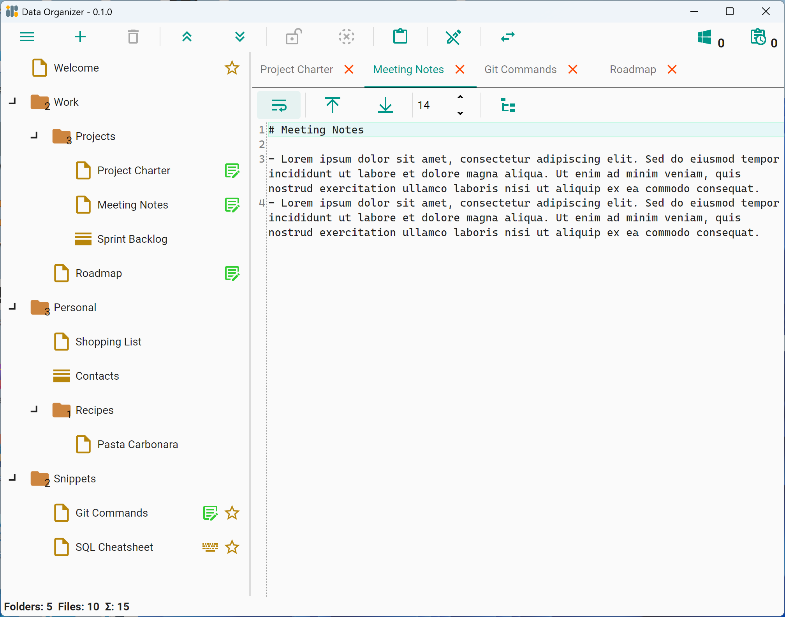
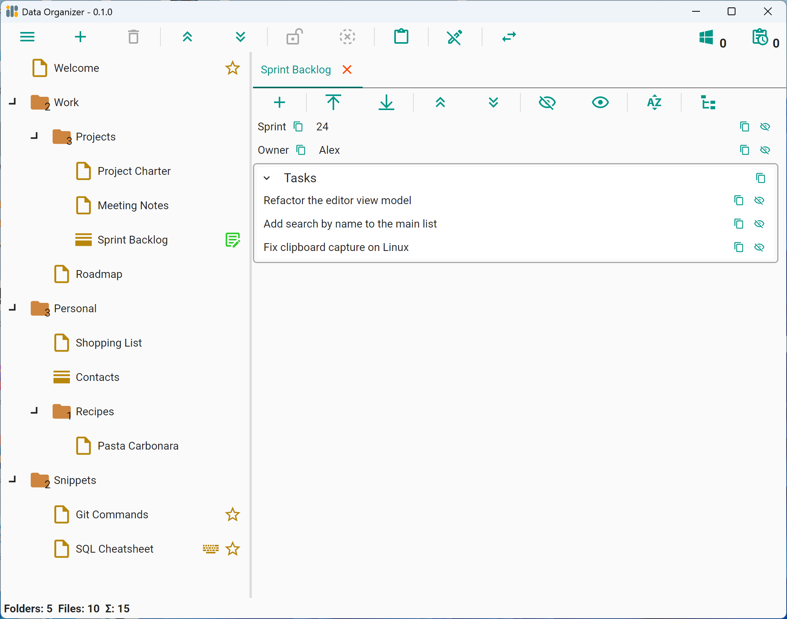
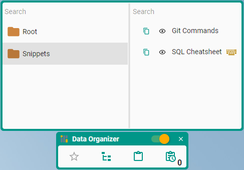
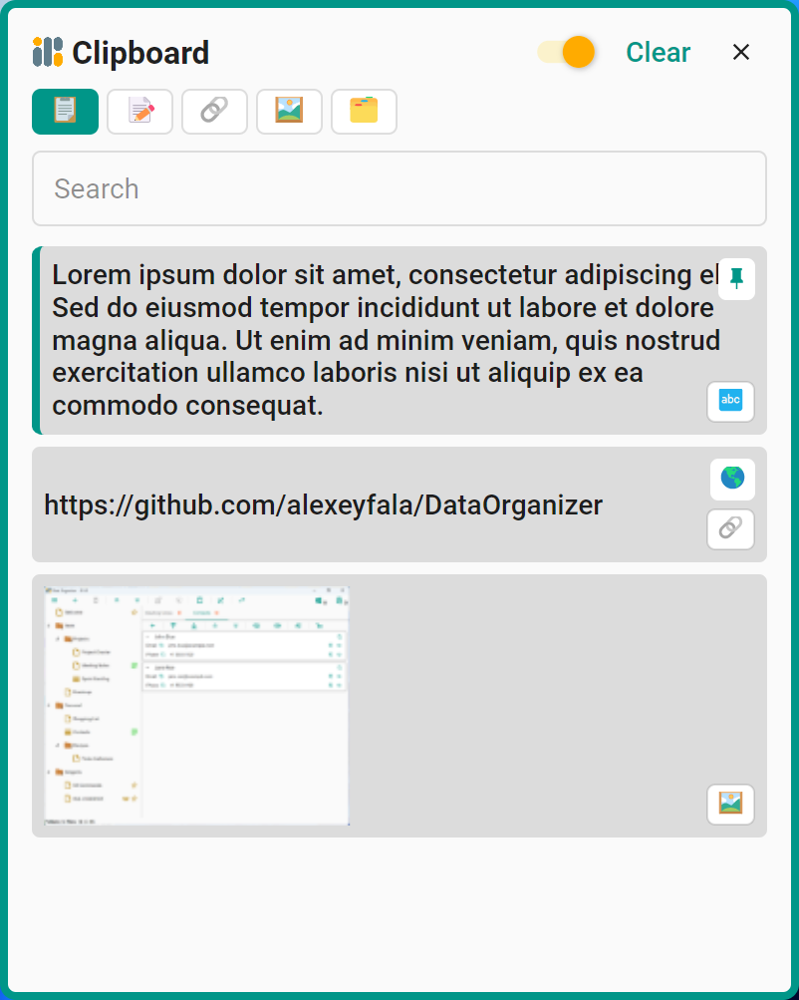

# Data Organizer

[](LICENSE)


**A cross-platform desktop application for organizing and securely storing structured data in a virtual file system.**

Built with [Avalonia UI](https://avaloniaui.net/) and .NET 11, following the MVVM pattern with data persisted to a local SQLite database via EF Core.

## Features

- **Virtual file system** — folders, files, and datasets arranged in a tree, saved to a local SQLite database.
- **Global hotkeys** — bind a file to a Ctrl/Alt/Shift shortcut; pressing it from any application copies the file's contents to the clipboard.
- **Favorites** — mark files for quick access; a dedicated searchable window groups them by parent folder.
- **Encryption** — password-protect folders. Contents are encrypted with XChaCha20-Poly1305 using a per-folder Data Encryption Key (DEK); the DEK is wrapped with a key derived from the password (Argon2id), and no password verifier is stored. The cost of the derivation is recorded with the wrapped key, so it can be raised later without making earlier data unreadable. A new password is rated as it is typed, and the rating is shown next to the input.
- **Datasets** — structured key-value records with a built-in editor for grouping and editing.
- **Clipboard history** — a cross-platform journal that captures plain text, formatted text (HTML/RTF), URLs, images, and files/folders. Entries can be browsed, searched, and restored; duplicates are merged, the list is capped, and password-manager secrets are skipped. Kept in memory by default, optionally persisted to an encrypted file (XChaCha20-Poly1305 + Argon2id).
- **Notepad** — a separate window for scratch texts in tabs, each with the same editor as the files, which open in tabs as well. Tabs can be renamed and reordered by dragging; the texts are kept between sessions as plain text (see [SECURITY.md](.github/SECURITY.md)).
- **File execution** — launch files with their OS-default application; execution history is tracked.
- **Import & export** — JSON, XML, and the full SQLite database.
- **Appearance** — Light, Dark, or System theme (Material Design), with configurable primary and secondary accent colors.
- **Localization** — English and Russian; resource-based, ready for additional languages.
- **Update notifications** — checks GitHub for a newer release on startup and offers to open the download page; each version is announced once and the check can be disabled in settings.

## Screenshots

**Main window** — hierarchical tree with the built-in text editor.



**Dataset editor** — structured key-value records and groups.



**Favorites** — quick access, grouped by parent folder.



**Clipboard history** — captured text, links, images, and files.




## System Requirements

64-bit (x64) only, on a processor with the x86-64-v2 instruction set (any x64 processor from about 2013 on). Requirements follow the .NET 11 runtime:

- **Windows** — Windows 10 version 1607 or later
- **Linux** — a modern glibc-based distribution (e.g. Ubuntu 22.04+, Debian 13+, Fedora 44+); see [.NET 11 supported distributions](https://github.com/dotnet/core/blob/main/release-notes/11.0/supported-os.md)
- **macOS** — macOS 15 (Sequoia) or later on an Intel (x64) Mac; on an Apple Silicon (ARM64) Mac it runs through Rosetta 2, which Apple supports for general apps up to macOS 27

The portable builds and the Linux and macOS packages are self-contained: the .NET runtime is bundled inside. The Windows installer (`.msi`) is not: it needs the [.NET 11 Runtime (x64)](https://dotnet.microsoft.com/download/dotnet/11.0) installed first.

## Platform Notes

- **Windows** — after the `.msi` installs or updates the application, its first start can take up to about three minutes before a window appears: with Smart App Control in evaluation mode, Windows 11 checks each unsigned library of the application online. Later starts take a few seconds.
- **Linux** — global hotkeys work without extra privileges in an X11 session. A Wayland session needs access to `/dev/input`, which is usually granted by a udev rule.
- **macOS** — Control+Tab, which returns to the previously selected tab in the editor and the notepad, does not work: macOS keeps the key press for moving the focus between controls, and Avalonia UI does not pass it on to the application.

## Build from Source

**Prerequisites:** [.NET 11 SDK](https://dotnet.microsoft.com/download/dotnet/11.0).

```bash
git clone https://github.com/alexeyfala/DataOrganizer.git
cd DataOrganizer
dotnet run --project src/DataOrganizer.Desktop
```

On macOS, run the platform host instead:

```bash
dotnet run --project src/DataOrganizer.MacOS
```

## Install Location

The installers place the application here by default:

```
%ProgramFiles%/DataOrganizer/                                 (Windows, all users)
%LOCALAPPDATA%/Programs/DataOrganizer/                        (Windows, current user)
/opt/com.alexeyfala.dataorganizer/                            (Linux, .deb and .rpm)
/Applications/DataOrganizer.app                               (macOS)
```

The AppImage (Linux) needs no installation: it runs from wherever the file is placed.

A Flatpak (Linux) is kept by Flatpak itself, in `~/.local/share/flatpak/app/com.alexeyfala.dataorganizer/` for a `--user` install or `/var/lib/flatpak/app/com.alexeyfala.dataorganizer/` for a system-wide one.

## Data Storage

All application data is stored locally:

```
%LOCALAPPDATA%/DataOrganizer/                                 (Windows)
/home/{username}/.local/share/DataOrganizer/                  (Linux)
/Users/{username}/Library/Application Support/DataOrganizer/  (macOS)
```

## Contributing

Contributions are welcome. See [CONTRIBUTING.md](.github/CONTRIBUTING.md) for build and workflow guidelines, and the [Code of Conduct](.github/CODE_OF_CONDUCT.md).

## Security

Vulnerability reports are handled privately — see [SECURITY.md](.github/SECURITY.md). Avoid filing public issues for security matters.

## License

Data Organizer is licensed under the **Apache License 2.0** — see the [LICENSE](LICENSE) file for the full text.

Third-party components are distributed under their own licenses; attribution and terms are listed in [THIRD-PARTY-NOTICES.txt](THIRD-PARTY-NOTICES.txt). Notably, the global-hotkey feature relies on the native `libuiohook` library (bundled with SharpHook), which is licensed under the **LGPL-3.0-or-later** and is linked dynamically. Required attribution notices are collected in the [NOTICE](NOTICE) file.
